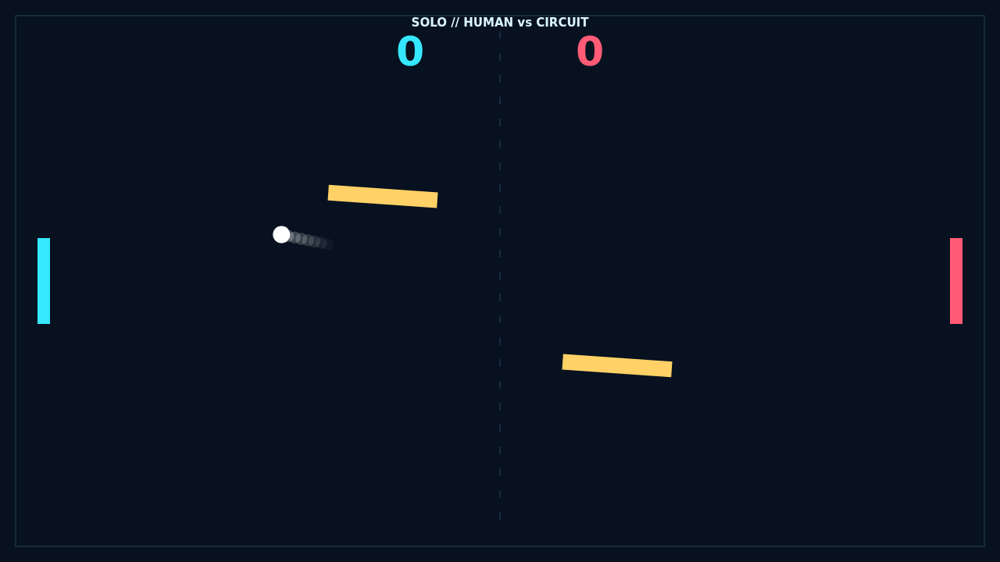

# Bend the angle

Carom opens with the ball suspended at center court, the twin gold bars already beginning their slow sweep. When the serve breaks, you have a moment to read the lane and meet it with the cyan paddle—or trust the circuit to return it in Solo.

Every moving strike adds spin. A clean center hit is direct, while a rising or falling paddle bends the flight after contact and makes the white trail curl visibly across the dark field.

The rotating obstacles make every exchange a bank-shot puzzle. Their changing faces can open a sharp route past the opponent or throw an ambitious shot back at you. Rallies accelerate with every paddle touch until one player slips the ball beyond the far edge.

At 10–10 there is no easy finish: Carom plays on until somebody leads by two. The last points are fast, curved, and wonderfully precarious.

